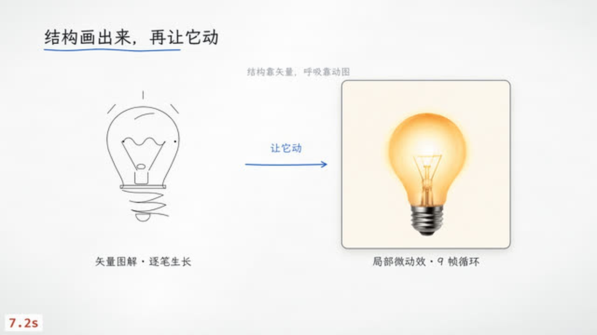

# whiteboard-teacher-video-motion · 矢量动效讲解视频

> 一个**独立可用**的手绘讲解视频 skill：把 AI 生成的原生 SVG 矢量图解，
> 和 GIF 拆帧后的局部真实微动效，接进「讲到哪画到哪」的确定性时间轴。



它解决的是一个很具体的问题：纯代码画的白板讲解片，音画对齐和确定性都很好，
**但图形质感粗糙、没有真实材质与光影的呼吸感**。这个 skill 只补这一层，
文字、箭头、强调、镜头仍然手绘。


已完成并验收的正片：11 页 / 33 句 / 121.9 秒，11 个 SVG 逐笔生长 +
10 个 GIF 拆帧循环，混排手绘机械运动、配比条、计数器、相机推镜。
确定性校验 11/11 页像素一致。

---

## 它和上游项目的关系

与 [`liangdabiao/whiteboard-teacher-video`](https://github.com/liangdabiao/whiteboard-teacher-video)
同源，但它**不是插件、不是补丁**：运行时脚本、安装器、页面 API 手册、免费配音后端、
离线样板全部随包提供。装了这一个就能跑，不需要先装上游项目。

引擎都是 [Frametell](https://github.com/sitor-ai/frametell)（`AGPL-3.0-only`），
由 `scripts/setup.py` 在安装时从上游 sparse checkout 拉取，**不进本仓库**。

---

## 快速开始（不联网、不花钱、不需要任何 API key）

仓库里 `examples/sample/` 已放好 1 个 SVG + 1 个 GIF 的原始素材。
先跑通这条离线链路，确认环境没问题，再考虑生成新素材。

```bash
# 1) 安装
git clone https://github.com/liangdabiao/whiteboard-teacher-video-motion.git
cd whiteboard-teacher-video-motion
python scripts/setup.py            # 拉引擎 ~16MB + npm 依赖 ~130MB
pip install Pillow edge-tts        # GIF 拆帧 / 免费中文配音

# 2) 复制样板到 skill 目录之外的项目位置（ftnew.py 会建引擎链接，项目不能放在 skill 里）
cp -r examples/sample D:/films/my-sample          # Windows；macOS/Linux 换成任意路径
python scripts/ftnew.py D:/films/my-sample --title "矢量动效样板" --style whiteboard

# 3) 素材 → 配音 → 质检 → 确定性 → 成片
python scripts/ftasset.py D:/films/my-sample --spec D:/films/my-sample/assets.json
python scripts/ftvoice.py D:/films/my-sample
python scripts/ftcheck.py D:/films/my-sample
cd D:/films/my-sample && node <skill>/scripts/ftdeterminism.mjs
cd <skill> && python scripts/ftrender.py D:/films/my-sample --fps 24
```

`ftasset.py` 看到 `assets/raw/` 已有素材会**直接复用、跳过 API**，因此第 3 步零费用。
成片在 `<项目>/out/`。

> `ftnew.py` 检测到目录里已有 `script.js` 时会保留现有内容，只补 `engine` /
> `engine_modules` 链接 —— 所以先复制样板、再跑它是正确顺序。

环境要求：Python 3.9+、Node ≥ 22.19、Chrome 或 Edge、git、ffmpeg（npm 依赖自带）。
`setup.py` 会逐项自检并把缺失项打印出来。

---

## 生成自己的素材（可选的付费步骤）

只想用自带素材，可以整节跳过。

1. 安装 [`apiz` CLI](https://apiz.ai) 并配置好 API Key（`apiz auth` / `apiz account balance`）。
2. 在项目里写 `assets.json`：

```json
{
  "defaults": { "quality":"low", "complexity":"low", "aspect_ratio":"1:1", "size":"1K" },
  "svg": [ { "name":"bulb-line", "prompt":"...clean native SVG vector paths..." } ],
  "gif": [ { "name":"bulb-pulse", "prompt":"...seamless loop...",
             "frame_count":9, "frame_duration_ms":200 } ]
}
```

3. `python scripts/ftasset.py <项目> --spec <项目>/assets.json`

模型固定用 `apiz/gpt-image-2.6-flare`。实测单价 **SVG ≈ ¥0.23 / GIF ≈ ¥0.25**
（100 积分 = ¥1）；11 页正片的 21 个素材合计约 ¥2.75。
素材是抽卡，`assets/raw/` 会保留原始下载并作为断点续用的依据——
中断后重跑全量不会重复花钱。`--only <name>` 只做一个、`--force` 重抽、`--dry-run` 只看计划。

⚠ `HTTP 429 — API Key 额度不足`：这是 **API Key 自带的独立额度**，
`apiz account balance` 显示有钱也一样会报（串行调用同样会报，不是并发问题）。
到控制台提高/重置该 Key 额度后重跑即可。详见 `references/vector-motion-guide.md` 坑 ⑥。

---

## 完整工作流

| 步骤 | 命令 / 动作 | 说明 |
|---|---|---|
| ① 分镜 | 读 `references/storyboard-method.md`，写 `storyboard.json` | **停下来把分镜念给用户确认**，这是唯一强制闸门 |
| ② 口播 | 写 `script.js`，`META.extras` 填四项 | 顺序不能反，见下 |
| ③ 建项目 | `python scripts/ftnew.py <项目> --title "..." --style whiteboard` | 项目放在 skill 目录之外 |
| ④ 素材 | `python scripts/ftasset.py <项目> --spec <项目>/assets.json` | 离线复用或付费生成 |
| ⑤ 配音 | `python scripts/ftvoice.py <项目>` | 默认 edge 免费；可选 apiz / 自备音频 |
| ⑥ 画面 | 逐页写 `pages/pNN.js` | `P.vector` / `P.clip` + 手绘混排 |
| ⑦ 质检 | `python scripts/ftcheck.py <项目>` | lint + 每页拼图，逐页看图 |
| ⑧ 终态 | `cd <项目> && node engine/tools/snap.mjs --only pNN <讲完时刻> --sheet pNN-final` | 结尾才出现的元素拼图看不全 |
| ⑨ 确定性 | `cd <项目> && node <skill>/scripts/ftdeterminism.mjs` | 含 `P.clip` 必跑 |
| ⑩ 成片 | `python scripts/ftrender.py <项目> --fps 24` | 产出有/无字幕 mp4 + srt |

`META.extras` 四项（顺序固定）：

```js
extras: ['extras/svg-assets.js', 'extras/clips.js',
         'extras/asset-manifest.js', 'extras/motion-svg.js']
```

页面里两种素材的写法：

```js
P.vector('bulb-line', 190, 260, 540, 540, {
  at: P.c(0), dur: 2.6, mode: 'draw', stagger: 0.55, fillDelay: 0.62,
});
P.clip('bulb-pulse', 1100, 260, 540, 540, {
  at: P.c(2), fps: 5, loop: true,          // 9 帧 × 200ms → 5fps
});
```

完整 API 见 `references/page-api.md`，实测边界与 8 个坑见
`references/vector-motion-guide.md`，skill 入口是 `SKILL.md`。

---

## 三条不能破的契约

1. **整片是时间的纯函数**：`renderAt(t)` 与之前播放过什么无关。
   所以 `.gif` 绝不能直接塞 `P.img`（浏览器按自己的时钟播），必须拆帧交给 `P.clip`。
2. **SVG 里的动画/脚本/外链/位图必须剥掉**，`ftasset.py` 落盘前自动处理；
   页面里禁止 `Math.random()` / `Date.now()` / `rAF`。
3. **素材变了，`extras/` 的哈希要跟着变**：引擎分段缓存的 digest 不 hash `assets/`，
   `ftasset.py` 写的 `asset-manifest.js` 就是让缓存感知素材变化的。

生成不确定，**渲染确定**：素材抽卡是唯一不确定的环节，落盘后每一帧都可复现。

---

## 仓库结构

```
SKILL.md                        skill 入口（AI 读这个）
README.md                       本文件
LICENSE                         MIT（仅自有代码）
package.json / package-lock.json 引擎所需的最小 npm 依赖
scripts/
  setup.py / setup.ps1          安装：拉 AGPL 引擎 + npm install + 环境自检
  ftnew.py / ftvoice.py / ftcheck.py / ftrender.py / ftlib.py / edge_tts_speak.py
  ftasset.py                    ★ 素材链路：生成/下载/清洗/拆帧/写 extras
  ftdeterminism.mjs             ★ 带帧解码等待的确定性校验
lib/motion-svg.js               ★ P.vector() 时间驱动 SVG 组件
references/                     页面 API、分镜、口播格式、风格包、TTS、排错、实测手册
examples/sample/                离线单页样板（含 1 SVG + 1 GIF 原始素材）
docs/                           示例画面
vendor/ATTRIBUTION.md           第三方归属与许可说明
```

`engine/` 与 `node_modules/` 不入库，由 `setup.py` 生成。

---

## 常见问题

**`ftcheck.py --determinism` 报一堆 nondeterministic？**
引擎那条校验不等待 GIF 帧解码，会对帧序列误报（实测 11 页误报 8 页）。
真实渲染 / 拼图 / 单帧三条路径都等待。请用 `scripts/ftdeterminism.mjs` 判定，别改引擎源码。

**渲染长片崩了，chunks 里只有 `.jobs-*.json`、0 个 mp4？**
引擎默认 12 个浏览器 worker，11 页以上会 OOM。本仓库的 `ftrender.py`
已把 `--workers` 默认设为 1，也可用 `--workers N` 调整。

**AI 生成的 SVG 少了几笔？**
模型偶尔把未求值算式（`132+142.857…`）或英文单词写进数值属性，浏览器静默丢弃。
`ftasset.py` 的清洗会就地求值 / 剔除坏路径；复用 `assets/raw/` 重跑不花钱。

**`P.svg is not a function`？**
组件方法叫 `P.vector()`，不叫 `P.svg` —— `Builder` 实例属性 `svg` 是画布 SVG 元素，
会遮蔽同名原型方法。

---

## 许可

| 部分 | 许可 | 说明 |
|---|---|---|
| 本仓库脚本 / 组件 / 文档 | **MIT** | `LICENSE`，Copyright © 2026 liangdabiao |
| Frametell 引擎 | **AGPL-3.0-only**（Sitor Team） | 不在仓库内，`setup.py` 从上游拉取、独立进程调用 |
| npm 依赖 | 各自许可 | 见 `package.json` |
| `examples/sample/` 内的 AI 素材 | 随包提供，供离线验收使用 | 由 GPT Image 2.6 Flare 生成 |

第三方归属详见 `vendor/ATTRIBUTION.md`。
**请不要把 AGPL 引擎源码拷进本仓库或闭源项目。**

---

作者：liangdabiao · <497070928@qq.com>
